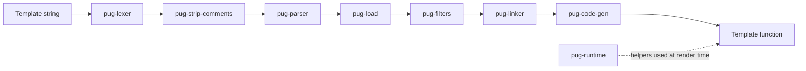

# Architecture

This document describes how Pug turns a template string into a rendered HTML string, which package owns each step, and where to extend the pipeline. It is written for contributors. For setup and the development workflow, see [CONTRIBUTING.md](./CONTRIBUTING.md).

## Overview

Pug is split into small packages that each perform one stage of compilation. The `pug` package is the public entry point: it wires the stages together, handles options and caching, and exposes `compile`, `render`, `compileClient` and the file-based variants.

A template goes through this pipeline:

The stages run in this order inside `compileBody` in `packages/pug/lib/index.js`. The plugin hooks listed in the next section run between them.

## Stages

| # | Package | Input | Output | Responsibility |
| --- | --- | --- | --- | --- |
| 1 | `pug-lexer` | Source string | Token array | Splits the source into tokens: tags, classes, ids, attributes, text, code, mixins, includes and so on. Written in TypeScript (`src/`), built to `lib/`. |
| 2 | `pug-strip-comments` | Token array | Token array | Removes comment tokens so later stages never see them. |
| 3 | `pug-parser` | Token array | AST | Builds a tree of nodes (`Tag`, `Text`, `Code`, `Mixin`, `Filter`, `Include`, `Extends`, `Block`, and so on). |
| 4 | `pug-load` | AST | AST with dependencies | Finds `include` and `extends` targets, reads them from disk (or the `read` hook), and runs the lexer and parser on each one. Uses `pug-walk` to find the nodes. |
| 5 | `pug-filters` | AST | AST with filter output | Runs every `:filter` block (for example `:markdown-it` or `:cdata`) at compile time and replaces the filter node with the resulting text. |
| 6 | `pug-linker` | AST with dependencies | Single AST | Resolves `extends` and `block` relationships so the result is one tree with no unresolved dependencies. |
| 7 | `pug-code-gen` | Linked AST | JavaScript source | Generates the body of a template function. Uses `pug-attrs` for attribute code. |
| 8 | Wrapping (in `pug`) | Function body | Template function | Turns the generated body into a function. By default it uses `pug-runtime/wrap`, which imports `pug-runtime`. With `inlineRuntimeFunctions` the helpers are inlined into the function via `new Function`. |

Each stage throws errors built by `pug-error`, which attach the filename and line of the offending source so users see a useful location.

## Runtime

`pug-runtime` is a small set of helpers that generated templates call while they run: `escape` for HTML escaping, `attr` / `attrs` / `classes` / `style` for attribute output, `merge` for combining attributes, and `rethrow`, which adds source context to runtime errors. It has no dependencies. Because it is shipped with every compiled template, changes to it affect the size and speed of all output and must stay backward compatible.

`pug-attrs` generates the code for a tag's attributes. It depends on `pug-runtime` because the generated code calls its helpers.

## Packages at a glance

| Package | Depends on (internal) | Role |
| --- | --- | --- |
| `pug` | all stage packages and `pug-runtime` | Public API and pipeline orchestration |
| `pug-lexer` | `pug-error` | Tokenizer |
| `pug-strip-comments` | `pug-error` | Comment removal |
| `pug-parser` | `pug-error` | Tokens to AST |
| `pug-load` | `pug-walk` | Include / extends loading |
| `pug-filters` | `pug-error`, `pug-walk` | Compile-time filters |
| `pug-linker` | `pug-error`, `pug-walk` | Extends / block resolution |
| `pug-code-gen` | `pug-attrs`, `pug-error`, `pug-runtime` | Code generation |
| `pug-attrs` | `pug-runtime` | Attribute code generation |
| `pug-runtime` | none | Helpers used by generated code |
| `pug-walk` | none | AST traversal |
| `pug-error` | none | Error objects with source locations |

Keep dependencies flowing in this direction. `pug-runtime`, `pug-walk` and `pug-error` are leaves and must not depend on any other Pug package.

## Public API

Defined in `packages/pug/lib/index.js`:

- `compile(str, options)` returns a template function.
- `render(str, options)` compiles and runs a template in one step.
- `compileFile(path, options)` and `renderFile(path, options)` read the template from disk. These use `pug.cache` when `cache` is enabled.
- `compileClient(str, options)` and `compileFileClient(path, options)` produce a function source string for use in the browser.
- `compileClientWithDependenciesTracked` returns the source along with the list of files it depends on, which bundlers use to rebuild.
- `__express(path, options, fn)` is the Express integration.
- `runtime` exposes `pug-runtime`.
- `filters` is the global filter registry. Filters passed in `options.filters` override entries with the same name.

## Extension points

### Plugins

Plugins are objects passed in `options.plugins`. Most hooks transform the output of a stage and run in pipeline order: `preLex`, `postLex`, `preParse`, `postParse`, `preLoad`, `postLoad`, `preFilters`, `postFilters`, `preLink`, `postLink`, `preCodeGen`, `postCodeGen`.

Three hooks replace a stage instead: `resolve` (locating included files), `read` (reading their contents) and `generateCode`. Only one plugin may implement each of these, and Pug throws if two do. The `lex` and `parse` entries add hooks inside the lexer and parser themselves.

### Filters

Filters are the `:name` blocks in a template. They are looked up in this order:

1. `options.filters`, then the global `pug.filters`.
2. A `jstransformer-<name>` package, resolved relative to the template file.

`options.filterOptions` supplies default options per filter name, and `options.filterAliases` maps one filter name to another. The filter guide in [packages/pug-filters/README.md](./packages/pug-filters/README.md) has examples.

## Where to make a change

| If you want to... | Start in |
| --- | --- |
| Add or change syntax (a new token) | `pug-lexer` (`src/`), then `pug-parser` |
| Change how a node compiles to JavaScript | `pug-code-gen` |
| Change attribute output | `pug-attrs` |
| Change include or extends behavior | `pug-load` and `pug-linker` |
| Change filter behavior | `pug-filters` |
| Change what generated templates call at runtime | `pug-runtime` (keep it backward compatible) |
| Change options, caching or the public API | `packages/pug/lib/index.js` |

Most syntax changes touch more than one stage. Add a test in each package that changes, and an end-to-end test in `packages/pug`.

## TypeScript status

`pug-lexer` and `pug-error` are written in TypeScript. Their TypeScript source lives in `src/`, and the build writes JavaScript and `.d.ts` files to `lib/`. The other packages are still JavaScript, and [TYPESCRIPT_MIGRATION_ROADMAP.md](./TYPESCRIPT_MIGRATION_ROADMAP.md) gives the order in which they will be converted. [TYPESCRIPT_CONVERSION_GUIDE.md](./TYPESCRIPT_CONVERSION_GUIDE.md) describes the steps for converting one package.

## Further reading

- [CONTRIBUTING.md](./CONTRIBUTING.md): setup, commands and pull request process
- [SECURITY.md](./SECURITY.md): threat model and vulnerability reporting
- [packages/pug-filters/README.md](./packages/pug-filters/README.md): filter authoring guide
